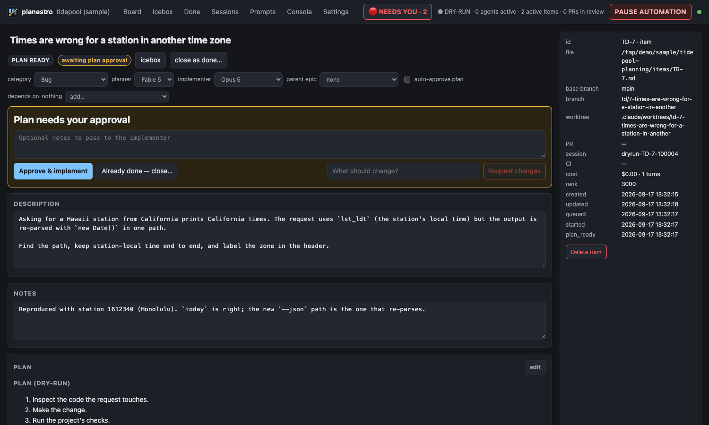
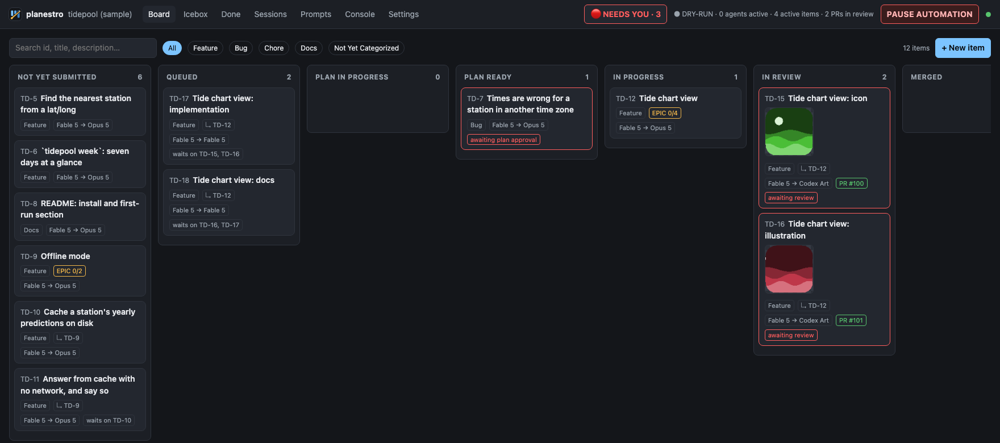
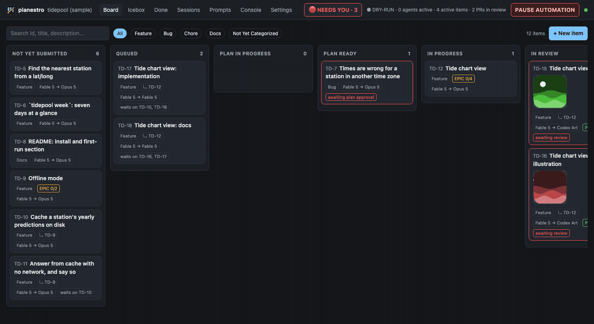
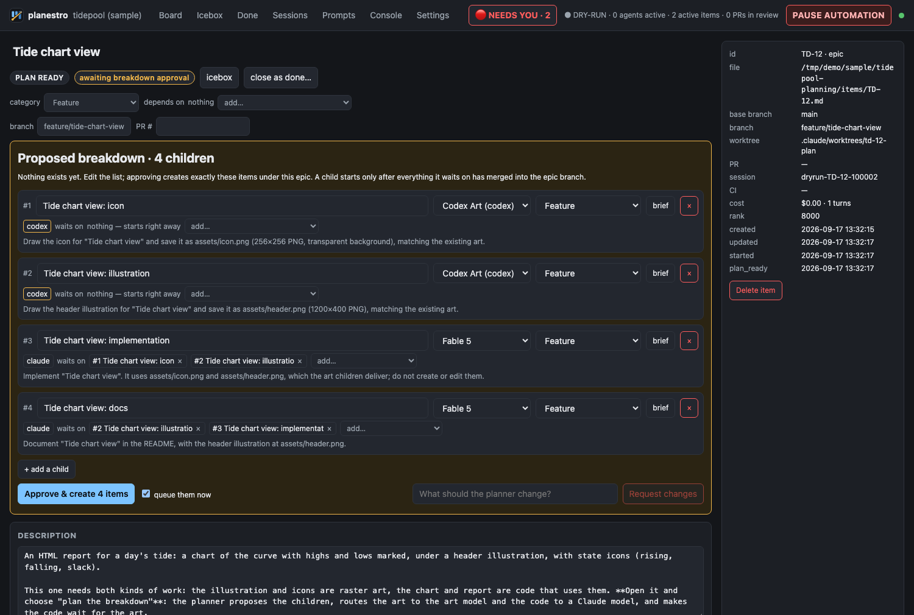
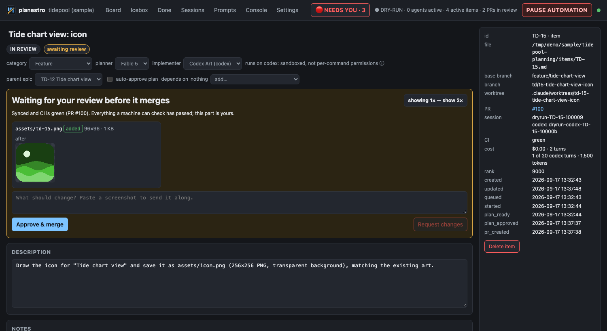

# planestro

[](https://github.com/gravesisme/planestro/actions/workflows/ci.yml)

**Your backlog, shipped by agents — with you at the decision points.**
Local-first planning and agent orchestration for a solo developer: a web app,
an API, anything that lives in a git repository with CI. Write an item in
markdown; [Claude Code](https://claude.com/claude-code) plans it; Claude Code or
the [Codex CLI](https://developers.openai.com/codex/cli) implements it; planestro
does everything mechanical in between.

**Queue** an item and planestro turns it into a plan you approve, an
implementation on its own branch and worktree, a pull request, a CI wait, a
rebase when the base moves on, a merge and a cleanup. Models do the thinking;
deterministic code does git, GitHub and CI. When an agent needs you — a plan to
approve, a permission, a question — its session is parked and the item turns
red. Answer whenever, even after a restart, and the same conversation resumes.



- **Parallel work without babysitting.** Several items in flight, each in its
  own worktree. A merge queue syncs each branch with the base and waits for
  green CI, so they land one after another on a base that stays green.
- **Pick the agent per item.** A Claude planner writes every plan; Claude or
  Codex implements it. An orchestrator session reviews plans, handles a second
  red CI run or a rebase conflict, and brings you only what needs you.
- **Nothing lives only in a conversation.** Items are markdown files in a
  git-versioned data dir, and every turn is rebuilt from them: kill the
  process, rotate the session, and nothing is lost.
- **Releases beside the backlog.** Each version's release notes, its store
  copy (counted against the store's limits) and the items it shipped.

**[Read the manual →](docs/README.md)**

It is used daily to build [Hurricane Harrison](https://hurricaneharrison.com),
a game on the App Store: several agents in parallel worktrees, every change
through a reviewed plan, a pull request and green CI — including
[features split across two agents](#features-split-across-two-agents), where
Codex draws the art and Claude writes the code that uses it.

## Try it in a minute — no repo, no GitHub, no Claude login

```sh
git clone https://github.com/gravesisme/planestro && cd planestro
npm install && npm run build
npm run sample          # http://127.0.0.1:4310
```

`sample` builds a fictional project (*tidepool*, a tide-times CLI) with a full
backlog — finished work with its history, a reviewed piece of art, a bug with
repro notes, two epics, an icebox, prompt templates for both agents — and
serves it with the engine in **dry-run**. Git, GitHub and both agents are the
in-memory fakes the test suite drives, so the whole lifecycle really runs:

1. Drag a card from **NOT YET SUBMITTED** to **QUEUED**. A worktree is
   "created" and a plan appears; the card turns red: it needs you.
2. Open it, read the plan, **Approve & implement**.
3. Watch it open a PR, wait for CI, merge, clean up and land in **Done**. The
   Console tab shows every `Would …` the real engine would have run.

4. For one feature split across two agents, open the **Tide chart view**
   epic → **plan the breakdown**, and follow
   [features split across two agents](#features-split-across-two-agents) below.

`npm run sample -- --reset` rebuilds it from scratch.

## Features split across two agents

Each model in `planestro.yml` carries a one-line description of what it is
for. Write one epic, and the Claude planner proposes the children, routes each
to the model whose description fits, and wires which waits on which. Code
checks the list (known implementers, no cycles) before you ever see it; you
edit it and approve. The children land on the epic's integration branch and
ship as one pull request.

The sample shows the case this was built for, pictures *and* code: raster art
routed to a Codex model that can generate images, the code that uses it to
Claude, waiting for the art.







Codex draws in its own worktree and commits. The pull request goes through sync
and CI like any other — then, instead of merging, it **parks for your eye**:
before/after thumbnails from git, approve, or send it back to the same Codex
thread with a note and a pasted screenshot.



Only when the art has merged do the code children start — their worktrees cut
from a branch that already holds the PNGs, their prompts listing exactly which
files were delivered. Then the epic lands as one pull request.
[The walkthrough →](docs/mixed-agent-epics.md)

The two agents are trusted differently, and the tool says so: a Claude worker
asks before anything unusual (a per-command policy, parked permission requests);
a Codex worker cannot ask, so it runs in a sandbox that cannot write outside its
worktree or reach the network. A Codex item that has to install a package or
reach a local database stops and says so, rather than working around it.
[Agents →](docs/agents.md)

## Why it is built this way

The interesting part is not that an LLM writes code; it is everything around
it that has to be boring and correct. The rules the codebase is held to (the
full list, with reasons, is in [`CLAUDE.md`](CLAUDE.md)):

- **Files are the truth.** One markdown file per item (YAML frontmatter +
  `# Description`, `# Notes`, `# Plan`, `# Activity`), a prompt library,
  small attachments and an NDJSON journal, in a git-versioned *data dir* with
  meaningful commits (`TD-6: approve plan`). Readable, greppable and editable
  without the tool.
- **Don't ask an LLM what a state machine can know.** Git, worktrees, GitHub,
  CI polling, transitions, persistence, cleanup and scheduling are code.
  The models plan, implement and make judgment calls — they never poll.
- **No process ever waits on a human.** Plan approval, a permission prompt or
  an agent's question parks the session: the request is persisted, the turn
  ends, the process exits, and the UI shows **NEEDS YOU**. Your answer resumes
  the same conversation — after a restart, too.
- **Claude is never the sole holder of anything needed to recover.** Every
  turn is rendered from persisted state; a reconciler cross-checks that state
  against the real world at startup and converges crash leftovers.
- **Destructive operations require positive evidence.** Nothing is deleted
  because state says it should be safe: cleanup needs a fresh fetch, the PR
  reported merged, and the tip proven reachable from the base. Ambiguity
  blocks with a reason; it never deletes.
- **Dry-run and a big red lever.** `engine.mode: dry-run` logs `Would …`
  instead of acting, and **PAUSE AUTOMATION** stops everything new after the
  current safe operation, across restarts.
- **Project-neutral.** A project is `{code_repo, data_dir}`. The data dir can
  live anywhere — for example an orphan branch of the code repo checked out as
  a nested worktree, so planning history never touches the code's branches.

## Lifecycle

```
NOT_YET_SUBMITTED → QUEUED → PLAN_IN_PROGRESS → PLAN_READY → IN_PROGRESS → IN_REVIEW → MERGED → FINISHED
                                  (planner)     (you approve)  (implementer)   (rebase, CI, merge)  (cleanup)
```

`ICEBOX` holds ideas; `blocked` / `awaiting` are orthogonal flags, so an item
never loses its phase when it needs you. Epics own a `feature/<slug>`
integration branch for chained children; items driven by something else
(another agent, a colleague) are watched rather than run. **Close as done**
finishes an item whose work landed some other way, without a PR.

An orchestrator session (a separate, freely rotated Claude conversation) wakes
on the ambiguous events — a plan to review, a second red CI run, a conflict —
and can instruct workers or escalate to you; it never owns state.

## Using it on your own project

```sh
npm install && npm run build
npx tsx packages/server/src/cli.ts init ../myproject-planning --repo ../myproject --name "My Project" --prefix MP
npm start -- ../myproject-planning --open     # http://127.0.0.1:4300
```

Requirements: Node 24, git, the GitHub CLI (`gh`, authenticated) and Claude
Code (`claude`, logged in); the Codex CLI (`codex`, logged in) if you route work
to it. The engine starts in `dry-run`; flip `engine.mode`
to `live` in Settings once you have watched a dry run against your repo.
Project rules come from your repo's own `CLAUDE.md` / `AGENTS.md`; planestro
adds nothing project-specific.

`serve --watch` is for working on planestro itself: web source changes rebuild
the UI and open pages reload; server changes restart it between agent turns
(automation is paused until running turns finish, then resumed).

### Running it in the background

`serve` runs in the foreground. For a server that should keep running after
the terminal (or the Claude Code session) that started it is gone, use `start`:

```sh
npm run planestro -- start ../myproject-planning --port 4300 --host 0.0.0.0 --watch
npm run planestro -- status
npm run planestro -- stop ../myproject-planning
```

- **`start [data_dir] [--port N] [--host H] [--watch]`** runs `serve` in a
  session of its own, logging to `<data_dir>/.planestro/serve.log`. It returns
  once the server answers, after reconciling items against their branches and
  worktrees, and prints the URL, the log path and any corrections. A server
  started as a Claude Code background task is killed at that task's time cap,
  along with the worker turns it is driving. A server from `start` is not. If
  the data dir's own server is already up on that port, `start` prints it and
  exits 0, so a wrapper script can run it every time. It refuses (and says what
  holds it) the same data dir on another port, a data dir another planestro
  holds, and a port something else listens on. It never stops or takes over
  another server. A data-dir lock whose pid now runs something unrelated is stale,
  and `start` removes it.
- **`stop <data_dir> | --port N | --all`** sends SIGTERM to the server's whole
  process group (npm, tsx, the server, and a `--watch` supervisor with whatever
  child it last restarted), then SIGKILL after 15 s. With no argument it stops
  the data dir in the current directory, and refuses rather than guessing when
  there is none. A server started some other way is found by its port or its
  data-dir lock and stopped on its own, never by its group, which may be a shell's.
  Anything that is not `planestro serve` is left alone.
- **`status [data_dir]`** lists every running instance on the machine (data
  dir, URL, pid and process group, uptime, log) and drops records whose process
  has gone.

Each instance is recorded in its data dir (`.planestro/instance.json`), with a
pointer in `~/.planestro/instances/`, so several projects can run side by side
on different ports, and stopping one never reaches another. A `--watch` instance
restarts whenever planestro's own source changes, so **editing or pulling the
planestro checkout restarts every instance on the machine that was started from
it with `--watch`**. A restart stays in the same process group, so `stop` still
catches it.

A consumer repo's scripts can be one line each. From a repo whose backlog is its
`planning/` directory, with planestro checked out beside it:

```sh
npm --prefix ../planestro run -s planestro -- start "$PWD/planning" --port 4300 --host 0.0.0.0 --watch
npm --prefix ../planestro run -s planestro -- stop "$PWD/planning"
```

### The backlog from any MCP client

A running server also serves the backlog over MCP at `/mcp` (streamable HTTP).
It is read-only and has three tools:

- `get_state`: the project, engine mode and pause, counts by status, and what
  is running, queued, blocked, waiting for you, waiting for review and open as a
  PR. It also lists the planestro instances running on the machine, from
  `planestro start`'s records.
- `list_items`: one summary line per item, filtered by `status`, `epic` (its
  children), `queued` or text `q`.
- `get_item`: one item in full.

Register it once per project, at **user scope**, under a name of its own.
`planestro status` prints each instance's MCP URL:

```sh
claude mcp add --scope user --transport http planestro-myproject http://127.0.0.1:4300/mcp
codex mcp add planestro-myproject --url http://127.0.0.1:4300/mcp
```

This is for you and your own sessions, never for planestro's workers, which
never touch planning state. Claude workers and the orchestrator run with
`strictMcpConfig`, so they load no user-scope or `.mcp.json` servers, and Codex
workers run with `--ignore-user-config`. A model whose `mcp` list names a
server pointing at a running planestro's `/mcp` is stopped (`mcp_missing`)
rather than given it. Tests pin all three. Don't add the endpoint to a project's
checked-in `.mcp.json`: your own sessions in that repo would get it, and
`strictMcpConfig` is the only thing between it and a worker.

> **The web UI has no authentication.** It binds to `127.0.0.1` by default and
> can start agents that edit and push code. Requests from other websites and
> DNS-rebinding tricks are refused, but `--host 0.0.0.0` exposes the UI to your
> whole network; only do that on a network you trust. See [SECURITY.md](SECURITY.md).

### Authentication and billing

Worker sessions are Claude Code sessions launched through the official Agent
SDK. By default they use whatever `claude` is logged in as. Anthropic's Agent
SDK docs ask that SDK-built agents use **API-key authentication** rather than a
claude.ai login, and the SDK is governed by the Commercial Terms — so set an
Anthropic Console key (Settings → *This machine* → Anthropic API key, stored in
the gitignored `planestro.local.yml`, or `ANTHROPIC_API_KEY` in the
environment) to bill the API directly. Never offer a claude.ai login to other
users of a tool built on this.

### What agents may do

Claude workers run with a permission policy (`packages/server/src/engine/policy.ts`):
pushes, PR operations and anything touching the base or release branches are
denied outright — integration is planestro's job, not the agent's — an allow
list covers the routine, and everything else parks as a permission request you
answer in the UI. Codex workers run in the Codex sandbox instead, and cannot
push either. Per-item budgets cap spend (`budget_usd_per_item`, and turns and
tokens for Codex).

## Layout

```
packages/shared   schema, item/prompt/release file codecs, ranks, transitions, placeholders
packages/server   store (atomic writes, journal, semantic commits), engine (ports,
                  policy, lifecycle, reconciler, orchestrator, SDK session port),
                  Hono API + WebSocket, CLI, the sample project
packages/web      React + Vite UI: board, item, sessions, releases, prompts, console, settings
docs/             the manual (start at docs/README.md); spike records in docs/notes/
spikes/           the runnable Phase 0 spike
```

The engine talks to the world only through four ports (git, GitHub, processes,
agents — Claude and Codex behind one contract). Live ports shell out; dry-run ports are an in-memory world. That seam
is why `npm test` can drive the real lifecycle — CI red then fixed, a rebase
conflict handed to the session, parked questions and permissions, a restart in
the middle of a turn, crash markers left on disk — in about twenty seconds with
no network.

```sh
npm test            # vitest
npm run typecheck
```

## Data dir editing rules

Hand-edit freely while planestro is not running — it commits your edits as
`manual: …` at startup. While it runs, planestro is the only writer; worker
sessions never touch the files either: they use the `submit_plan`, `add_note`,
`append_activity`, `report_done` and `report_blocked` tools instead. Schema
changes ship as migrations (`planestro migrate <data_dir>`); an older dir
opens read-only until you run it, a newer one until you upgrade the tool.

## Status

A working tool built for one person's workflow, shared as-is. Developed and
used on macOS; Linux runs the test suite in CI; Windows is untried. One project
per server process. The Claude Code and Agent SDK versions it was validated
against are pinned in `packages/server/src/compat.ts`, and it warns when the
installed CLI has drifted.

## License

[MIT](LICENSE)
