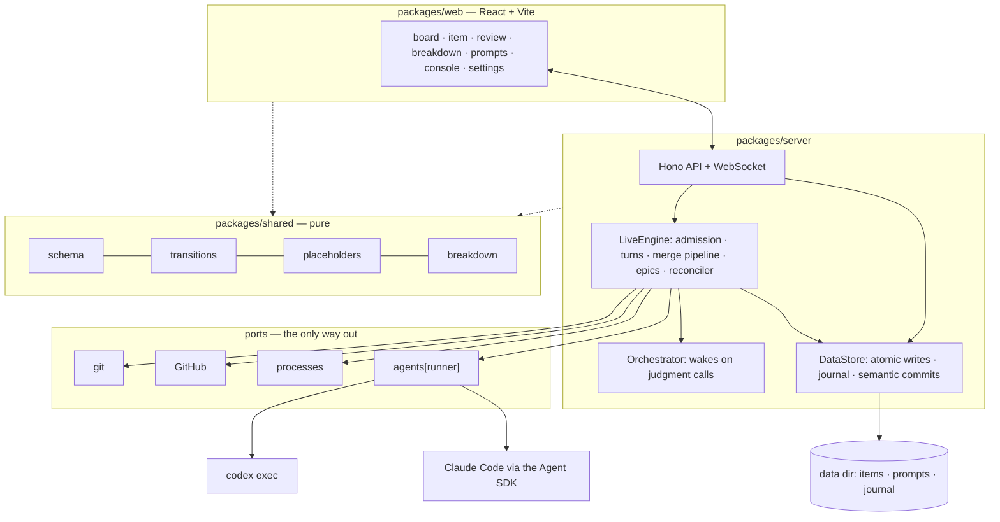

# Architecture

## Ports

The engine touches the world through four interfaces (`engine/ports.ts`): **git**,
**GitHub**, **processes**, and **agents** — a record keyed by runner, each with the same
`runTurn` contract. *Live* ports shell out or call the SDK; *dry-run* ports are one
in-memory `FakeWorld`. Nothing else in the engine knows which it has. That seam is why the
test suite drives the real lifecycle — CI red then fixed, a conflict handed to the session,
parked questions and permissions, a restart mid-turn, crash markers on disk, a mixed-agent
epic — in under half a minute with no network, and why `sample` can show the whole product
without credentials.

`TurnOptions` is split by type: `AgentTurnOptions` is what every runner needs;
`ClaudeTurnExtras` (permission mode, tool allow-list, per-command decisions, dollar budget)
is what only Claude can honour. The Codex port is typed on the first, so it *cannot* read
the second. An invariant test keeps runner names out of lifecycle code.

## The state machine

`shared/src/transitions.ts` is the whole truth about status: one table of
`{from, to, by, flavors}` rows — who (user, engine, orchestrator) may make which move for
which kind of item (worker, epic, external). The API, the UI's buttons, the board's drag
targets and the engine all ask the same table. `blocked`, `awaiting` and `op` are
orthogonal to status, so needing a human never loses an item its phase.

## A turn

1. Render the prompt from the library and the item's files — never from agent memory.
2. Persist `op` and journal *begin*; take a runner slot; call `agents[runner].runTurn`.
3. The agent reports through tools (Claude) or its final message (Codex). A question, a
   permission request or a plan **parks**: persisted, the tool call answered "recorded — end
   your turn", the process exits.
4. Book cost / tokens / conversation id; journal *end*.
5. Decide from facts: parked or blocked → stop. Dirty tree → send it back to commit. No
   commits → block. Otherwise push and open the pull request.

## The merge pipeline

For each IN_REVIEW item, serialised: sync the branch with its base (worker branches rebase
with `--force-with-lease`; integration branches merge, never rewritten — and a branch
already on the base tip whose remote matches is left alone, its existing CI run reused,
so entering the pipeline never re-pushes an identical commit) → if CI is already green for
that exact commit, re-check holds → record what the branch delivered → merge → verify
GitHub says MERGED → **cleanup**, which deletes the worktree and branches only after a
fresh fetch proves the tip is reachable from the base. Red CI goes back to the item's
session with the log; a second red blocks.

Only the sync and the merge are serial. A commit whose CI is not green yet leaves the chain
as `op: awaiting_ci` and is waited for beside it (`watchCi`: GitHub, or the local check when
Actions cannot run), so one item's slow CI never holds up another's merge (dogfood p15: a
review-held item's twenty-minute CI wait kept three approved merges queued behind it). Green,
it is either parked on its hold or goes back into the chain, which merges it if it is still on
the base tip and syncs it again if another merge moved the base meanwhile. Merge order decides
who goes first among the items ready to go; an item still waiting on CI holds no one back.
Releasing a hold keeps a green run when a fresh fetch shows the same head, still on the base
tip; otherwise its CI is asked for again.

GitHub reports a just-replaced head for a few seconds after a push. `waitForCi` treats the
pre-push sha as propagation lag (90 s grace) rather than as a moved head; before that, the
first poll aborted the merge as `head_moved`, released the chain, and every queued item
rebased and pushed in turn — one merge fired a fresh CI run per open PR.

## The reconciler

At startup, every five minutes and on demand, persisted state is compared with git and
GitHub: stale `op`s from a crash are converged, a pull request opened just before a crash is
adopted, a merge made outside planestro is observed, a moved branch tip discards its CI
verdict, a missing worktree blocks (never recreated: local commits could be lost), orphans
are reported. It never deletes on its own authority.

## Storage

Item, prompt and release files are written atomically (temp file + rename) and parsed back before a
write is accepted. Every operation is journaled begin/end in NDJSON. Semantic changes
commit immediately with a message scoped to the paths they touched; telemetry (costs,
timestamps) is checkpointed. A lock file makes planestro the single writer of a data dir.
Schema changes ship as ordered migrations.
