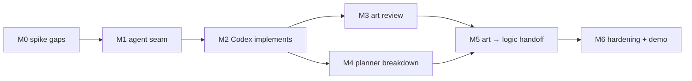

# Epic: mixed-agent features — Codex art blocking Claude logic

Companion to [`codex-integration.md`](codex-integration.md) (spike findings and
the design this plan stages). Written 2026-09-17; nothing below is built.

## The outcome, as one demo

> I write one epic: *"Add a Frost Wand: icon, projectile sprite, and the weapon
> itself."* I queue it. The Claude planner proposes four children — two art
> items routed to Codex, two logic items routed to Claude, the logic waiting on
> the art. I fix one title and approve. Codex draws the icon and the sprite in
> their own worktrees; each parks with before/after thumbnails; I send one back
> with a note, approve both, and they merge into the epic branch. Only then do
> the Claude items start, already seeing the new PNGs and told which files
> their dependencies delivered. They land, the epic PR opens, CI is green, it
> merges. I touched it four times and never opened a terminal.

Every milestone below is judged by how much of that paragraph it makes true.

## Ground rules (the invariants, applied to this epic)

- **One seam.** The engine reaches agents through exactly one call
  (`ports.claude.runTurn`, `LiveEngine.ts`). Codex goes behind that seam; the
  lifecycle, merge pipeline, reconciler and store do not learn its name.
- **State machine over LLM.** Routing (which runner), holds, "which files did my
  dependencies deliver" and "is it done" stay deterministic code.
- **No process waits on a human.** A Codex question or an art review parks the
  item exactly like a Claude question does; the answer resumes the thread.
- **Dry-run first.** Every milestone ships its fake port and an engine test that
  drives the new path to FINISHED with no network, before any live run.
- **Additive schema.** New keys are optional; no data-dir migration is planned.
  If one becomes necessary it goes through `migrations/` like the last one.
- **Honest trust model.** Claude workers have a per-command policy with parked
  permission requests; Codex workers have a sandbox and after-turn
  verification. The docs and the UI say which one an item is running under.

## Milestones

Sizes are focused working sessions (a session ≈ what landed on 2026-09-17).

### M0 — Close the spike's gaps · ½ session · go/no-go gate

The spike proved the happy path. Three unknowns can still change the design.

- **Image-to-image** (`codex exec -i ref.png`): does the image tool *edit from*
  an attached image headless, or only read it? The sprite pipelines that start
  from a rig render depend on this.
- **Approvals under `workspace-write`**: what does `exec` do when the model
  wants something the sandbox forbids (network, a write outside the worktree)?
  Expected: a refusal in the transcript. Confirm it never blocks on a prompt.
- **Failure shapes**: killed mid-turn then resumed; expired login; rate limit;
  a nonexistent thread id. Record exit codes and the NDJSON each produces.
- **Config isolation**: does `--ignore-user-config` still read the repo's
  `AGENTS.md`? If not, use a dedicated `-p planestro` profile instead.
- Catalogue the remaining `item.type`s (`file_change`, reasoning, tool calls).

**Deliverables:** `spikes/codex-spike.ts` (runnable, like the SDK spike),
findings appended to `codex-integration.md`, `VALIDATED_CODEX_VERSION` in
`compat.ts` with the same startup drift warning Claude Code gets.
**Exit:** image-to-image verdict recorded. If it fails, art items are limited
to text-to-image and M3's "request changes with an annotated screenshot"
becomes text-only — the epic still stands.

### M1 — The agent seam · 1 session · no behaviour change

Make room for a second runner without adding one.

- `ClaudePort` → `AgentPort`; `Ports.claude` → `Ports.agents: Record<Runner, AgentPort>`
  with `Runner = 'claude' | 'codex'`. The orchestrator keeps using `claude`.
- `ModelDef` gains optional `runner` (default `claude`), `codex_model`, and
  `description` (one line on what the model is *for* — M4 feeds it to the
  planner). `init`'s template and the Settings table show them.
- `LiveEngine.runTurnFor` resolves the phase's model → runner → port. A model
  whose runner cannot plan is refused as a planner in the store and filtered
  in the UI (the way `external` models already are).
- `TurnOptions` splits what is Claude-specific (`permissionMode`,
  `allowedTools`, `onPermission`, `maxBudgetUsd`) from what every runner needs,
  so a port that ignores them does so by type, not by accident.

**Acceptance:** the whole suite passes unchanged; `invariants.test.ts` gains
"no file under `engine/` outside `sessions/` names a runner".
**Risk:** this is a rename across the engine and its tests — do it alone, in
one commit, so the next milestone's diff is only new code.

### M2 — Codex implements · 2 sessions · first user-visible value

A Claude-planned item whose implementer is a Codex model runs end to end.

- `sessions/LiveCodexPort.ts`: spawn `codex exec [resume <id>] --json
  -s workspace-write -C <worktree> --add-dir <attachments> --output-schema …
  -o … -m <codex_model>` with **stdin ignored**; tolerant NDJSON parser →
  `onOutput` lines for the console; final message → `done` / `blocked` /
  `question` (parks with `awaiting: question`; the answer resumes the thread);
  abort → SIGTERM → `subtype: 'killed'`, resumable; `thread_id` persisted as
  `session_id`; spawn failure → `spawn_error` with the CLI's stderr tail.
- `prompts/worker-system-codex.md` (partial): commit on this branch, never
  push, never touch other branches, end with the schema. `implement-plan` is
  reused as is.
- Budgets: `budget_turns_per_item` (tokens are recorded in `op_data`, shown on
  the item, and not enforced yet). `cost_usd` stays 0 for Codex turns and the
  UI shows turns/tokens instead of a misleading `$0.00`.
- A minimal hold: items whose implementer has `hold_for_review: true` get
  `skip_merge` set when their PR opens, and the item page gains a
  **Release hold** button (there is no UI for `skip_merge` today). M3 replaces
  the button with a real review; this keeps unreviewed art out of any branch
  in the meantime.
- The item page and Sessions list show the runner; the trust-model sentence
  appears on Codex items.
- `DryRunCodexPort` beside the Claude fake.

**Acceptance (automated):** engine tests on dry-run ports — Claude plans, Codex
implements → FINISHED; a Codex question parks and the answer resumes the same
thread id; `blocked` blocks with the reason; a restart mid-turn resumes; the
hold stops the merge until released. A **port test with a fake `codex` binary**
(a script that emits recorded NDJSON) covers the parser, the stdin rule, abort
and a malformed final message — without the network.
**Acceptance (live):** one real art item on a real repo: queue → Claude plan →
approve → Codex draws and commits → PR → hold → release → merged.
**Decision needed before starting:** which Codex model id is the default, and
whether Codex items share `max_sessions` or get their own concurrency limit
(image generation is slow and rate-limited; recommendation: own limit, 1).

### M3 — Art is reviewed by eye · 1–2 sessions

Replace "Release hold" with a review built for images.

- Server: `GET /items/:id/images` — deterministic, from git: files with image
  extensions added or changed between the base and the item's branch, each with
  a before (if any) and after blob served from the worktree / `git show`. No
  LLM involved. A size guard blocks the PR with `asset_too_large` over a
  configurable limit.
- Item page and preview drawer: before/after thumbnails on a checkerboard, at
  1× and at the project's display scale (config: `review.image_scale`), click
  to zoom. **Approve art** releases the hold; **Request changes** resumes the
  Codex thread with the note, and — if M0 cleared image-to-image — any pasted
  or annotated screenshot attached via `-i`.
- `awaiting: art_review` joins the NEEDS YOU set; the board card shows the
  first thumbnail.
- `prompts/art-item.md` (template, startable from the Prompts page): subject,
  size, palette/style references as attachments, where the files go, and a
  slot for the project's provenance rule (for the game: a `LICENSES.md` row per
  new asset source) so CI does not bounce art for paperwork.

**Acceptance:** engine test — art item parks on `art_review`, request-changes
resumes the same thread and re-parks, approve merges; API test for the image
diff on a fixture repo (added, changed, deleted, oversize).
**Live:** the M2 item again, this time sent back once with a note.

### M4 — The planner breaks an epic down · 2 sessions

Queueing an epic produces its children.

- Epic planning turn: a Claude plan-mode turn in a temporary worktree cut from
  the epic's base (the pattern `LiveEngine` already uses for epics and
  app-policy externals), with one extra tool, `submit_breakdown`: the epic-level
  plan plus children `{title, description, implementer, category,
  depends_on: [index…]}`. Validation is code: known implementers, acyclic
  dependencies, no child depending on itself, at least one child.
- New transition path for epics: `QUEUED → PLAN_IN_PROGRESS → PLAN_READY`
  (`awaiting: breakdown_approval`) → approve creates the children through the
  store (ranked in dependency order, `parent` set) and opens the epic;
  **Request changes** re-runs the turn with the note, like a plan today.
- UI: the proposed children as an editable list — retitle, re-route to another
  implementer, delete, reorder, add one by hand — before approving.
- The planner is told what each implementer is for from `models[].description`
  and `runner`, as data in the prompt (`plan-epic.md`), e.g. *"codex-art: all
  raster art. Claude models cannot generate images."* It is also told the
  rule that keeps M5 mergeable: children of one epic do not edit the same
  files; art children deliver files, logic children consume them.
- `DryRunClaudePort` submits a canned two-art / two-logic breakdown.

**Acceptance:** engine test — epic queued → breakdown parked → edited and
approved → four children exist with the right parents, runners and
dependencies; a cyclic or unknown-implementer breakdown is rejected back to the
planner with the reason, not shown to the user.

### M5 — Art hands off to logic · 1–2 sessions · the demo becomes true

- When a dependency merges into the epic branch, the dependent child's
  worktree is cut from (or synced to) the updated epic branch — verify the
  existing `depends_on` + epic-branch behaviour does exactly this, and fix it
  if a child queued early holds a stale base.
- `{{dependencies.delivered}}` in `plan-item` / `implement-plan`: for each
  merged dependency, its title and the files it added or changed (from git).
  The logic worker is told *"HH-101 delivered `assets/icons/frost_wand.png`
  (512×512 RGBA)"* instead of being left to find it.
- Orchestrator: a wake on `art_review` pending longer than a configurable time
  (nudge, never approve); epic summary lists children by runner.
- The sample project gains a mixed epic so `npm run sample` shows the whole
  flow in dry-run, thumbnails included (the fake Codex port writes a generated
  placeholder PNG).

**Acceptance:** one engine test is the demo paragraph at the top of this
document, on dry-run ports, asserting order (no logic turn starts before both
art children are MERGED) and the delivered-files text in the logic prompt.
**Live:** the Frost Wand epic — or its real equivalent — on the real project.

### M6 — Hardening and the story · 1 session

- Rate-limit and auth-expired detection → `blocked` with a reason that says
  what to do, not `turn_error`; backoff on retry.
- Token budgets enforced, with the numbers from real M2–M5 runs.
- `docs/codex-integration.md` rewritten from "design" to "how it works";
  README gains a mixed-agent section and one screenshot of an art review;
  `docs/going-public.md` updated; a recording of the M5 demo.

## Decisions to make before M2 starts

1. **Default Codex model id** and whether art and (any future) Codex *code*
   items are separate `models[]` rows. Recommendation: one row,
   `codex-art`, described as art-only, so the planner never routes logic to it.
2. **Concurrency:** own limit for Codex turns (recommended, default 1) vs
   sharing `max_sessions`.
3. **Where art lands:** let the planner's child description name the target
   paths (recommended — the repo's `AGENTS.md` / `CLAUDE.md` already describe
   the asset layout) vs a per-project `art.output_dirs` allow-list enforced
   after the turn.
4. **Hold scope:** hold every Codex item for review (recommended while the
   trust model is a sandbox only) vs only items that change image files.

## Out of scope for this epic

Codex as a *planner* or as the orchestrator; any third runner; audio or 3D
generation; automatic art QA (palette/size gates belong to the project's own
CI, as they do today); more than one project per server process.

## Tracking

planestro's own backlog points at the project it manages, not at planestro.
To run this epic through planestro itself, give the planestro repo its own
data dir (`planestro init … --repo .`) and serve it on a second port; M1 and M2
are well-shaped items for that. Otherwise tick them off here:

- [ ] M0 spike gaps — image-to-image verdict: ______
- [ ] M1 agent seam
- [ ] M2 Codex implements (decisions 1–2 made: ______)
- [ ] M3 art review
- [ ] M4 planner breakdown
- [ ] M5 art → logic handoff
- [ ] M6 hardening + demo
