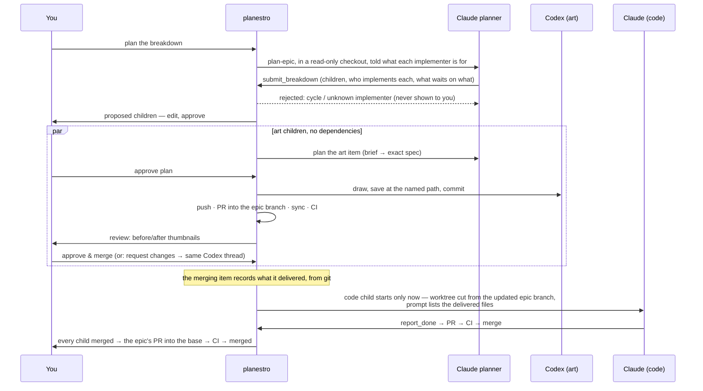

# Mixed-agent epics

One feature that needs both pictures and code: planned once, drawn by Codex, built by
Claude, the code waiting for the art. This page walks the whole flow. Setup: a Codex model
in `models` with a `description` and `hold_for_review: true` ([Agents](agents.md)).

## 1. Write the epic

Say what the feature is and put art direction in the notes: palette, sizes, what it sits
next to. You do not list the children. Choose **Epic** in the New item dialog; an item that
turns out to be one is caught when its plan comes in, and **Convert to epic** carries its
description and plan over ([Item or epic](concepts.md#item-or-epic)).

## 2. Plan the breakdown

Open the epic → **plan the breakdown**. The planner runs in plan mode in a *detached,
read-only* checkout of the base branch, and is given every implementer's id, runner and
description, the categories, and the rules that keep children mergeable:

- children of one epic do not edit the same files — an art child **delivers** files at named
  paths, a code child **consumes** them;
- `depends_on` only where the need is real, so independent children run in parallel;
- an art brief names the exact path, pixel size, format and the look to match; each child's
  description is a complete brief, because its worker sees nothing else.

It hands the list in with `submit_breakdown`. A child may also name its **planner** (any model
that can plan; by default the epic's own planner plans it, so an outage of the project default
does not reach every child) and ask to be **held for review** (`hold_for_review`: its pull
request waits for your look before it merges). **Code validates it** — known implementers,
planners and categories, real indexes, no cycles, a sane size. A bad list is answered with the reason and
the planner fixes it; you only ever see a list that can be created.

## 3. Edit and approve

The item parks on `awaiting: breakdown_approval`. Retitle, re-route a child to another
implementer or planner, hold it for review, rewrite a brief, drop or add a child, fix what waits on what — the same
validation runs as you type. **Approve & create** makes exactly the items on screen, under
the epic, in dependency order; removes the planning checkout; opens the integration branch;
and (by default) queues them. Only you can approve a breakdown: the orchestrator cannot.

When a child's planner is not its implementer, its planning prompt ends with **who implements
this plan**, from that model's label, runner and description, so a Claude planner writes a brief for
an image model instead of planning to draw the images itself.

## 4. Art is drawn, then reviewed by eye

Each art child is planned like any item — the planner turns the brief into an exact spec —
and, once you approve the plan, drawn by Codex in its own worktree and committed. Its pull
request goes through sync and CI as usual. Then, because its model is `hold_for_review`,
the item **parks on `awaiting: review`** instead of merging:

- every image the branch added or changed, *before* beside *after*, on a checkerboard, at
  1× and at `review.image_scale`× (a pixel-art project sets its display scale);
- **Approve & merge**, or **Request changes** with a note — and a pasted, annotated
  screenshot if words are not enough. The note goes to the *same Codex thread*, which
  revises and commits; the item comes back for another look.

The list of images comes from git, not from the agent's account of what it made.

## 5. Code starts when the art has landed

A child with `depends_on` stays QUEUED, with no worktree, until everything it names has
merged into the epic branch. When it starts:

- its worktree is cut from the epic branch as it is *then* — the PNGs are in it;
- its planning and implementing prompts carry a **Delivered by the items this one waited
  on** section: each dependency, merged, and the files it added or changed with sizes and
  pixel dimensions, recorded at merge time. The worker is told to use them as they are, and
  that a missing one is a reason to report blocked, not to improvise a substitute.

## 6. The epic lands

When every child has merged, the epic's pull request into the base opens (unless
`epics.auto_submit` is off), and goes through the same sync, CI and merge.

## What to expect from the art model

From the live runs this was built against: it follows a precise brief well, resizes and
checks alpha on its own, and asks instead of guessing when told to match art that does not
exist. Image-to-image *edits from* a reference (same subject, pose, framing) but repaints
the whole picture: anything that must stay pixel-exact needs your project's own finishing
step. Put sizes, palette and paths in the brief, and put the rules that never change in the
repository's `AGENTS.md`.
